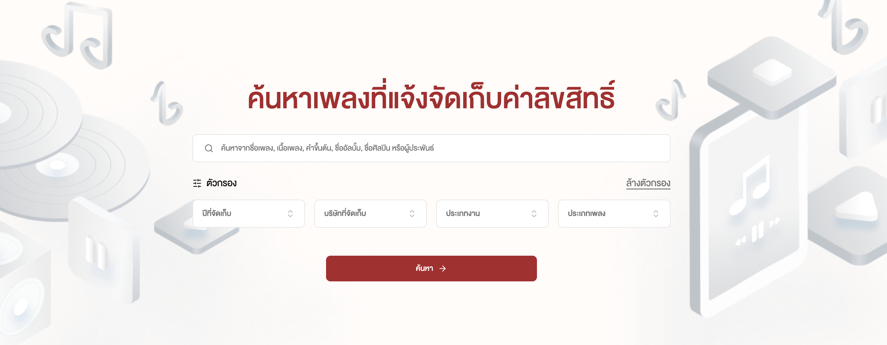
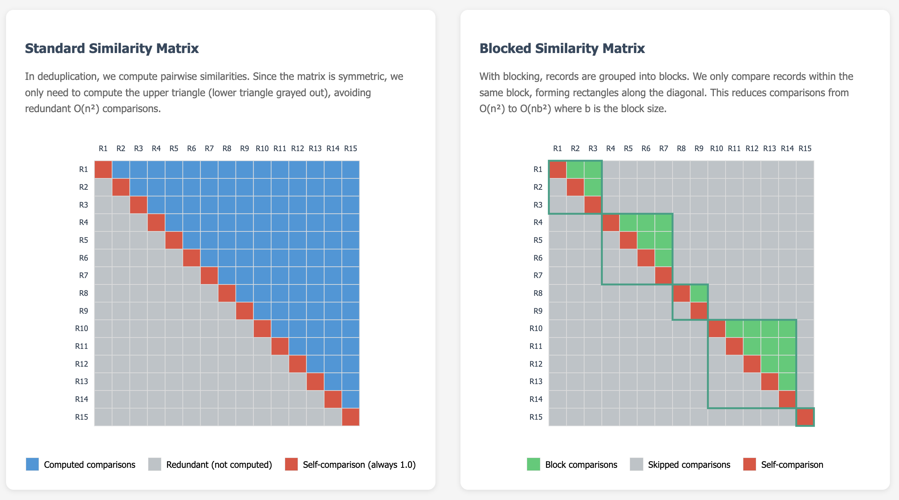

ช่วงปีที่ผ่านมาทางทีมของผมและทีมจากบริษัท ฟังใจ ได้มีโอกาสทำระบบค้นหาเพลงที่แจ้งจัดเก็บค่าลิขสิทธิ์ จริงๆไอเดียนี้ผม กุกกิก และทีมฟังใจมีแนวคิดที่จะพัฒนากันมานานตั้งแต่ช่วงโควิด และเราได้คุยกับทางกรมทรัพสินทางปัญญามาสักพักหนึ่งเนื่องจากอยากที่จะทำระบบออกมาให้ประชาชนเข้าถึงและค้นหาเพลงได้ง่ายขึ้นเนื่องจากระบบเดิมยังไม่ตอบโจทย์ในหลายด้าน: ค้นหาเพลงได้ยาก, ระบบการตรวจเพลงซ้ำซ้อนทำงานได้ช้า, หน้าตาเหมือนระบบทั่วไปที่เข้ามาค้นหาข้อมูลได้ยาก

ดังนั้นการค้นหาเพลงจึงทำได้ยาก เราอยากให้ระบบทำงานได้ง่ายขึ้นและประชาชนเข้าถึงเพลงต่างๆได้ดียิ่งขึ้น เช่น ถ้าเราเป็นร้านค้าที่อยากเปิดเพลง "เล่นของสูง" เราสามารถค้นหาเพลงเพื่อดูว่าบริษัทใดเป็นผู้ถือลิขสิทธิ์เพลงเล่นของสูง และเข้าไปดูอัตราจัดเก็บลิขสิทธิ์ของบริษัทนั้นได้ จากนั้นก็เข้าไปดูรายละเอียดของบริษัทเพื่อติดต่อและสอบถามต่อกับทางบริษัทจัดเก็บได้ สำหรับใครที่ยังไม่เห็นภาพ อาจจะเข้าไปทดลองใช้งานได้ที่ 
(copyright-song.ipthailand.go.th)[https://copyright-song.ipthailand.go.th/]

<figure>

  

  <figcaption>
    <a title="Reinforcement Learning Workflow">
      รูปที่ 1: หน้าแรกของระบบค้นหาเพลงที่แจ้งจัดเก็บค่าลิขสิทธิ์
    </a>
  </figcaption>

</figure>

<figure>

  

  <figcaption>
    <a title="Reinforcement Learning Workflow">
      รูปที่ 2: ผลลัพธ์การค้นหาเพลง และดูอัตราการจัดเก็บลิขสิทธิ์ของแต่ละบริษัท
    </a>
  </figcaption>

</figure>

## ว่าด้วยลิขสิทธิ์เพลง

(Disclaimer: อาจไม่ถูกทั้งหมดเนื่องจากผู้เขียนไม่ได้มีความรู้ลึกด้านลิขสิทธิ์เพลง)

ก่อนที่จะพูดถึงระบบเราอาจจะต้องพูดให้เห็นภาพโดยสังเขปก่อนว่าลิขสิทธิ์เพลงคืออะไร ลิขสิทธิ์เริ่มต้นจากศิลปินทำเพลงออกมาให้เราฟัง อาจมีค่ายเพลงหรือไม่มีก็ได้ จากนั้นเพลงเหล่านี้จะถูกจัดเก็บผ่านบริษัทจัดเก็บ เพื่อนำไปใช้ โดยการจัดเก็บมีทั้งในรูปแบบดนตรีกรรม (Musical Works) ซึ่งหมายถึงองค์ประกอบของเพลง เช่น ทำนอง คำร้อง และโครงสร้างทางดนตรี และสิ่งบันทึกเสียง (Sound Recordings) เช่น เทป ซีดี หรือเทปบันทึกการแสดงของศิลปินในประเทศไทย มีองค์กรจัดเก็บค่าลิขสิทธิ์หลักๆ เช่น MCT (Music Copyright Thailand) เป็นต้น

โดยแต่ละบริษัทมีหน้าที่จัดเก็บและเก็บเงินจากการใช้งานเพลงในรูปแบบต่างๆ เช่น การเปิดเพลงในร้านอาหาร การใช้ในงานอีเวนท์ หรือการออกอากาศทางสื่อ เพื่อนำกลับไปจ่ายศิลปินในรูปแบบของ Royalty หรืออาจจะเป็นในรูปแบบของการขายเทป ซีดี ก็ได้

> "ออกไปร้านค้าแล้วหนึ่ง cd
> คุณชุบชีวิตเราได้ royalty
> ทุกบาทที่คุณมอบให้คือกำลังใจให้เราสื่อสาร
> พวกเราอิ่มท้อง
> คุณสนุกสนาน"
> ผลิตภัณฑ์นี้รับประกันร้อยปี, Apartment Khunpa, 2006

## กรมทรัพย์สินทางปัญญามีบทบาทอะไร?

เนื่องจากเพลงต่างๆที่จัดเก็บมาจากหลายบริษัทและต้องแจ้งกับทางภาครัฐ เพื่อทำให้เกิดความโปร่งใสและทราบร่วมกันว่าบริษัทใดจัดเก็บเพลงใดบ้าง  บทบาทของกรมทรัพย์สินทางปัญญาจึงเป็นการรวมเพลงเหล่านี้ ทำระบบให้ผู้ใช้งานทั่วไปเข้ามาค้นหาเพลงที่สนใจ แจ้งเพลงที่ซ้ำซ้อนเพื่อให้ประชาชนเลือกใช้เพลงจากบริษัทที่ถูกต้องและตรงกับการใช้งาน แล้วให้ประชาชนทั่วไปสามารถซื้อลิขสิทธิ์เพลงได้อย่างถูกต้อง เป็นที่มาของการทำระบบค้นหาเพลงที่แจ้งจัดเก็บค่าลิขสิทธิ์นั่นเอง

## Pain points ของระบบเดิมที่ต้องแก้ไข
การพัฒนาระบบค้นหาเพลงสำหรับฐานข้อมูลลิขสิทธิ์มีความท้าทายที่ระบบก่อนหน้าไม่ตอบโจทย์ ซึ่งแบ่งเป็นจุดที่แก้ไขทางเทคนิคได้ประมาณ 3 หัวข้อหลักๆคือ

1. **ข้อมูลที่หลากหลายและไม่เป็นมาตรฐาน**
ข้อมูลเพลงที่ได้รับจากแหล่งต่างๆ มักมาในรูปแบบที่แตกต่างกัน บางครั้งชื่อเพลงเขียนเป็นภาษาไทย บางครั้งเป็นภาษาอังกฤษ หรือผสมกัน ชื่อศิลปินอาจสะกดต่างกันไป และโครงสร้างไฟล์ CSV หรือ Excel ที่ได้รับมามักมี column ที่ไม่ตรงกัน ดังนั้นการทำให้ format ของการเก็บเหมือนกันทั้งหมดและรองรับไฟล์หลายประเภทตอนนำเข้าจึงเป็นโจทย์แรกที่เราทำ เพื่อให้ระบบใช้งานได้ง่าย
2. **ข้อมูลเพลงซ้ำซ้อนที่ต้องตรวจสอบ**
เพลงเดียวกันอาจถูกจัดเก็บจากหลายบริษัท บางครั้งอาจจะมีชื่อที่แตกต่างกันเล็กน้อย เช่น "รักเธอ" กับ "รัก เธอ" (เว้นวรรค)  "Love Song" กับ "Love song" (ตัวใหญ่ตัวเล็ก) หรือ 1นาที กับ หนึ่งนาที การตรวจจับและจัดการข้อมูลซ้ำซ้อนจึงต้องใช้การประมวลผลภาษามาช่วยระดับนึง ระบบก่อนหน้าไม่ได้ใช้เทคนิคที่ช่วยจัดกลุ่ม และไม่ได้ทำ normalization ทำให้การตรวจไม่สมบูรณ์และเจ้าหน้าที่ต้องมาทำซ้ำอีกหลายเดือน ดังนั้นเราอยากจะทำระบบให้ทุกอย่างเกิดขึ้นอัตโนมัติและสามารถตรวจสอบเพลงซ้ำซ้อนในสเกลนี้ได้
3. **Scale ของข้อมูลที่ต้องค้นหาใหญ่มาก**
ในแต่ละปีมีเพลงที่สามารถค้นหาได้กว่า 10 ล้านเพลง ระบบก่อนหน้าใช้การโหลดไฟล์ซึ่งเข้าถึงเพลงได้ยาก ดังนั้นโจทย์ที่สำคัญอีกอย่างคือการพัฒนาระบบที่ประชาชนค้นหาเพลงได้เร็วด้วยทรัพยากรที่จำกัด สามารถ index เพลงได้ทั้งหมด 10 ล้านเพลงต่อปี และทำงานได้รวดเร็วเพียงพอในข้อมูลสเกลนี้

## เทคนิคที่เรานำมาแก้ปัญหาจากระบบเดิม

### **1. การนำเข้าข้อมูล (Data Import)**
เพื่อแก้ไขข้อมูลนำเข้าที่มีหลากหลาย เราจึงใส่ส่วนที่รองรับการจัด columns ในการนำข้อมูล CSV และ Excel เข้าสู่ฐานข้อมูล PostgreSQL อย่างอัตโนมัติ เนื่องจาก columns และจำนวนแถวของไฟล์ที่ได้รับมามีหลากหลายมาก ในที่นี้เราใช้ fuzzy matching เพื่อจับคู่กับ columns ที่ได้

เราใช้ Similarity score ได้แก่ Levenshtein Distance และ Jaro-Winkler Distance ในการคำนวณความคล้ายคลึงระหว่างชื่อ column ที่ได้รับกับ column ที่ระบบคาดหวัง และให้ผู้ใช้งานตรวจสอบก่อนนำเข้าข้อมูล

### **2. การตรวจจับข้อมูลซ้ำซ้อน (Deduplication)**
เพื่อแก้ไขข้อมูลเพลงซ้ำซ้อนที่เจ้าหน้าที่ต้องตรวจสอบทุกปีและใช้เวลานานมากกว่าหลายเดือน ระบบต้องมีการทำ deduplication คือการตรวจจับเพลงที่ซ้ำซ้อนกันในสเกลหลักล้านเพลง แต่ใช้เวลาคำนวณน้อยและใช้ทรัพยากรน้อย เราแบ่งการทำงานเป็น 4 ขั้นตอนย่อย ดังนี้

- **ขั้นตอนที่ 1: Normalization** เราทำการ normalize ข้อมูลเพื่อให้การ blocking และ deduplication ทำได้ดียิ่งขึ้น เช่น หนึ่งชั่วโมง, 1 ชั่วโมง ปรับให้เป็นฟอร์แมตเดียวกันเพื่อให้ง่ายต่อการทำ blocking หรือการจับกลุ่มข้อมูลเพื่อหาความซ้ำซ้อนนั่นเอง
- **ขั้นตอนที่ 2: Blocking** ปกติถ้าเราจะเทียบเพลง 10 เพลงด้วยกัน อาจจะต้องใช้การจับเพลงเป็นคู่แล้วประเมินว่าคู่เพลงนี้จะซ้ำซ้อนกันมั้ย ถ้าคำนวณแบบปกติอาจจะต้องจับคู่เพื่อทดสอบ 10 * 9 / 2 = 45 ครั้งซึ่งจะใช้การประมวลผลมากเกินจำเป็น (รูปที่ 1) ในเชิงคอมพิวเตอร์เราใช้ big-O notation เพื่อบ่งบอกปริมาณการคำนวณที่เกิดขึ้นเทียบกับจำนวนข้อมูล ในที่นี้อาจเขียนได้เป็น \\(O(n^2)\\) ดังนั้นแทนที่จะเปรียบเทียบทุกคู่ นักวิจัยที่ทำงานด้าน deduplication ใช้เทคนิค blocking เพื่อจัดกลุ่มเพลงที่มีโอกาสซ้ำกันไว้ด้วยกันหลังจากเพลงถูก normalize แล้ว (Note ว่าการ normalize ใช้แค่สำหรับการจับคู่ แต่ว่าเรายังเก็บข้อมูลเดิมไว้อยู่) หลังจากที่ทำ blocking แล้วเราจะได้กลุ่มของเพลงที่เรานำมาทดสอบเพื่อหาความคล้ายแทนที่จะต้องทำทุกคู่เพลง โดยการคำนวณจะลดจาก \\(O(n^2)\\) เหลือ \\(O(nb^2)\\) โดย \\(b\\) เป็นขนาดเฉลี่ยของแต่ละกลุ่มแทน ซึ่ง \\(b\\) จะเล็กกว่า \\(n\\) มากๆในกรณีนี้

เนื่องจากระบบที่ให้มีทรัพยากรน้อย เราเลือกใช้ Locality-Sensitive Hashing (LSH) เปลี่ยนข้อมูลเป็นชุดตัวเลขเพื่อหา similarity โดยเรานำเทคนิคนี้มาช่วย blocking เพื่อให้ใช้ทรัพยากรน้อยและทำงานได้เร็ว – ทดลองเทียบกับการทำ blocking แบบใช้ Jaccard similarity แบบเต็มรูปแบบแต่เร็วและใช้ทรัพยากรน้อยกว่ามาก ถ้าดูจากภาพด้านล่างจะเห็นว่าการทำ blocking ช่วยลดการคำนวณไปได้เยอะมากๆและทำให้ระบบสามารถตรวจสอบเพลงซ้ำซ้อนในกลุ่มที่เล็กลงได้

<figure>

  

  <figcaption>
    <a title="Reinforcement Learning Workflow">
      รูปที่ 3: การทำ Blocking สามารถลดความซับซ้อนการคำนวณเพลงที่มีโอกาสซ้ำซ้อนได้
    </a>
  </figcaption>

</figure>

**ขั้นตอนที่ 3: Similarity Calculation** สำหรับเพลงในกลุ่มเดียวกัน เราคำนวณความคล้ายคลึงโดยใช้ similarity หลายแบบในการประเมิน บาง field อาจจะเป็น exact match เช่น ชื่อผู้แต่ง แต่ว่าบาง field เช่น เนื้อเพลง อาจจะใช้ Jaro-Winkler Distance ที่ประเมินความคล้ายในช่วงต้นมากกว่าช่วงท้าย

**ขั้นตอนที่ 4: Merge Duplicates** เมื่อพบเพลงซ้ำตามกฎที่ทางกรมฯตั้งไว้ เราจะเก็บข้อมูลคู่ของเพลงซ้ำซ้อนและสถานะของความซ้ำซ้อนไว้แบ่งเป็น เข้าข่ายซ้ำซ้อน และ ซ้ำซ้อน แล้วเก็บไว้ใน relational database เพื่อใช้ในการค้นหาต่อไป

### **3. การค้นหาเพลงจากฐานข้อมูลขนาดใหญ่**

โจทย์ที่ท้าทายที่สุดอย่างหนึ่งในการทำระบบนี้คือ "Scale ของข้อมูล" ครับ เมื่อเราพูดถึงคลังเพลงที่มีทั้งเพลงไทยและสากล ซึ่งมีอัตราการเติบโตและเคลื่อนไหวของข้อมูลสูงถึง 10 ล้านเพลงต่อปี ในขณะที่ฝั่งผู้ใช้งาน (User Experience) นั้นมีความคาดหวังที่สูงลิ่ว คือต้องค้นหาได้ทุกอย่าง ไม่ว่าจะเป็น ชื่อเพลง, เนื้อเพลง, ผู้ประพันธ์, ค่ายเพลง และ Metadata อื่นๆ ได้อย่างรวดเร็วท่ามกลางข้อมูลมหาศาลนี้

ทีมเราได้ทดสอบ Framework และ Search Engine มาหลายตัวมาก (รวมถึงตระกูล Java เจ้าตลาด) แต่ท้ายที่สุด ผู้ชนะที่ตอบโจทย์เราที่สุดคือ “Typesense” Open-source Search Engine ม้ามืดที่เข้ามาแก้ปัญหาของเราได้อย่างตรงจุด ด้วยเหตุผล 6 ประการครับ:

1. **ความเร็วระดับปีศาจ (Blazing Fast Performance)**
หัวใจของ Search Experience คือ "ความเร็ว" Typesense ออกแบบสถาปัตยกรรมมาให้เก็บ Index ไว้ใน Memory (RAM) เป็นหลัก ทำให้การเข้าถึงข้อมูลเร็วกว่าการอ่านจาก Disk หลายเท่าตัว ผลลัพธ์ที่เราได้คือ Search Latency ที่ต่ำกว่า 50 มิลลิวินาที (<50ms) ซึ่งเร็วในระดับที่ผู้ใช้ยังไม่ทันกะพริบตา

2. **จิ๋วแต่แจ๋ว: ประหยัดทรัพยากร (Resource Efficient)**
ข้อจำกัดสำคัญของโปรเจกต์นี้คือ Infrastructure ที่มี RAM ค่อนข้างจำกัด Search Engine ทั่วไปมักจะกินทรัพยากรเครื่องมหาศาล (Resource Heavy) แต่ Typesense ถูกออกแบบมาให้จัดการ Memory Footprint ได้ดีเยี่ยม จากสเปกที่ทาง Typesense เคลมว่าใช้ RAM เริ่มต้นเพียง 20 MB... ซึ่งจากการใช้งานจริง เราพบว่าเครื่องที่มี RAM เพียง 2 GB ยังรับมือกับ Index เพลงหลักสิบล้านได้แบบเหลือๆ ช่วยให้เราประหยัดงบประมาณในการอัปเกรด Server ไปได้มาก

3. **High Availability: ระบบล่มไม่ได้ เพราะดนตรีต้องเล่นต่อเนื่อง**
นอกจากความเร็วแล้ว ความเสถียร (Reliability) คือสิ่งที่ต่อรองไม่ได้สำหรับแอปพลิเคชันที่มีผู้ใช้งานระดับนี้ หากระบบค้นหาล่ม ผู้ใช้งานจะรู้สึกว่าแอป "พัง" ทันที Typesense ตอบโจทย์เรื่องนี้ด้วยสถาปัตยกรรมแบบ Clustering ที่รองรับการ Scale และทำ Redundancy ได้อย่างไร้ข้อจำกัด มั่นใจได้ว่าระบบจะพร้อมให้บริการเสมอ

4. **เจาะลึกข้อมูลด้วย Faceted Search**
โจทย์ของเราไม่ได้มีแค่การค้นหา "ชื่อเพลง" แต่ User ต้องสามารถกรอง (Filter) ข้อมูลที่ซับซ้อนอย่าง เนื้อเพลง, ผู้ประพันธ์ หรือ ค่ายเพลง ได้อย่างแม่นยำ Typesense โดดเด่นมากในเรื่อง Faceted Search ซึ่งช่วยให้เราจัดการ Data Structure เพื่อรองรับการแสดงผลบน UI ได้อย่างยืดหยุ่น และที่สำคัญคือเขียนโค้ดจัดการในฝั่ง Python ได้ง่ายมาก

5. **เข้าใจภาษาไทย ไม่ต้องจูนเยอะ (Native Thai Support & Typo Tolerance)**
Pain Point คลาสสิกของ Search Engine ส่วนใหญ่คือมักจะเก่งแค่ภาษาอังกฤษ แต่ Typesense รองรับการตัดคำภาษาไทยได้ดีตั้งแต่เริ่มต้น (Out-of-the-box) แถมยังมีฟีเจอร์เด็ดอย่าง Typo Tolerance (พิมพ์ผิดก็ยังหาเจอ) เมื่อนำมารวมกับความเร็วในการประมวลผล ทำให้เราสามารถทำระบบ Instant Search ที่ User พิมพ์ปุ๊บ ผลลัพธ์เด้งขึ้นมาปั๊บ (Visual feedback) ได้ทันที ช่วยยกระดับ UX ให้ดูลื่นไหลและทันสมัยขึ้นมาก

6. **มี HTTP Server พร้อมลุย (Developer Friendly)**
ในมุมมองของนักพัฒนา ข้อนี้ช่วยลดงานไปได้มหาศาล เพราะ Typesense สื่อสารผ่าน HTTP/REST API ได้โดยตรง นั่นหมายความว่าเราไม่จำเป็นต้องเสียเวลาเขียน Backend Middleware มาคั่นกลางให้วุ่นวาย Frontend หรือ Application สามารถยิง Request คุยกับ Search Engine ได้เลย ทำให้เราขึ้นงานต้นแบบ (Prototype) ได้ไว ปรับแก้หน้างานได้คล่องตัว และยังช่วยกระจายความเสี่ยง (Decouple) ไม่ให้ Backend รับภาระหนักจนกลายเป็น Single Point of Failure อีกด้วย

โดยภาพรวมแล้ว การเลือก Typesense ไม่ใช่แค่การเลือกเครื่องมือค้นหาที่เก่งเทพที่สุด แต่คือการหาจุดสมดุลระหว่าง "ความคล่องตัว" ของทีมพัฒนา และมอบ "ความเร็ว" สูงสุดส่งงานให้กับผู้ใช้งาน ในทรัพยากรที่คุ้มค่าที่สุดสำหรับโปรเจกต์ที่มีข้อมูลมหาศาลระดับนี้

## สรุป

การพัฒนาระบบค้นหาเพลงที่แจ้งจัดเก็บค่าลิขสิทธิ์มีการออกแบบให้จัดการกับข้อมูลที่หลากหลาย ปริมาณมาก และมีข้อจำกัดด้านทรัพยากร การนำการประมวลผลทางภาษาที่ไม่จำเป็นต้องแฟนซี เช่น fuzzy matching, deduplication, และ search engine ทำให้ระบบสามารถทำงานได้อย่างมีประสิทธิภาพและตอบโจทย์ได้

ระบบนี้ไม่เพียงช่วยให้ประชาชนทั่วไปสามารถค้นหาและซื้อลิขสิทธิ์เพลงได้อย่างถูกต้องตามกฎหมาย และอาจจะเป็นส่วนช่วยให้ศิลปินและผู้สร้างสรรค์งานเพลงได้รับค่าตอบแทนที่ควรจะได้อย่างเป็นธรรมผ่านการค้นหาที่สะดวกมากขึ้น ถึงแม้ว่ายังมีอีกหลายปัญหาที่เราต้องพัฒนาและแก้ต่อไป ทีมของผมก็หวังว่าเครื่องมือนี้จะเป็นส่วนนึงในการสนับสนุนอุตสาหกรรมเพลงไทยในอนาคตครับ
